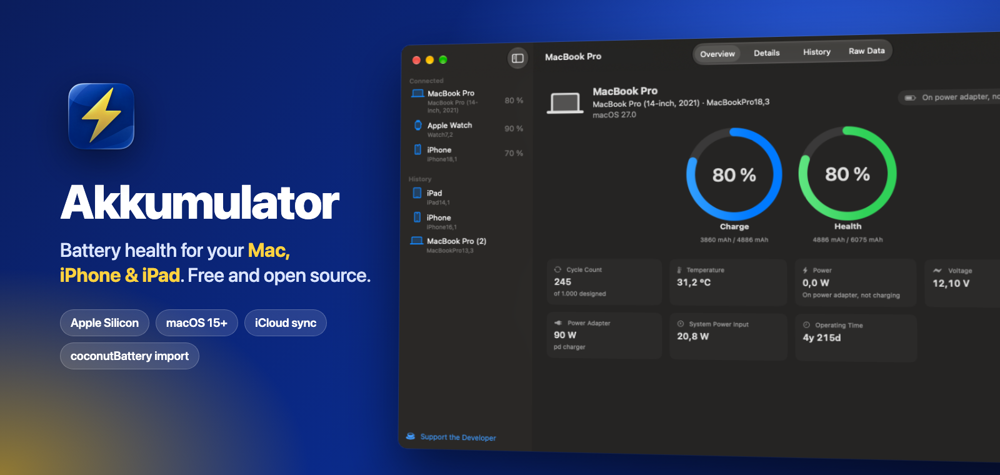

<p align="center">
  
</p>

<p align="center">
  <a href="https://github.com/fwilldev/Akkumulator/releases/latest"></a>
  
  
  <a href="LICENSE"></a>
  <a href="https://ko-fi.com/fwilldev"></a>
</p>


# Akkumulator

[English](README.md) · [Deutsch](README.de.md) · [Français](README.fr.md) · [Español](README.es.md) · [Italiano](README.it.md) · [Português (Portugal)](README.pt-PT.md) · [Português (Brasil)](README.pt-BR.md) · [简体中文](README.zh-Hans.md) · [한국어](README.ko.md) · **日本語**

Akkumulatorは、macOS用の無料のオープンソースのバッテリー状態確認アプリです。MacBookのバッテリーはもちろん、接続したり、Wi-Fi経由でペアリングしたりしたiPhoneやiPadのバッテリーについても、状態、充放電回数、容量、温度など、さまざまな情報を確認できます。

## なぜAkkumulatorなのか

ほかのバッテリーアプリとの比較（2026年10月時点）：

| | Akkumulator | [coconutBattery](https://www.coconut-flavour.com/coconutbattery/) | [Mac 4 Breakfast](https://github.com/onekapisch/Mac-4-Breakfast) | [iStat Menus](https://bjango.com/mac/istatmenus/) | [Juicy](https://getjuicy.app) |
|---|:-:|:-:|:-:|:-:|:-:|
| 価格 | 無料 | 無料、Plusは有料 | 無料、フル版は$4.99 | 有料 | 有料 |
| オープンソース | ✓ (MIT) | ✗ | ✗ | ✗ | ✗ |
| iPhone/iPadのバッテリーの状態 | ✓ | ✓ | ✓ | ✗ | ✓ |
| Wi-FiでiPhone/iPadを確認 | ✓ | Plus | ✓ | ✗ | – |
| Bluetoothアクセサリ（残量） | ✓ | ✗ | ✓ | ✓ | ✓ |
| iCloudで履歴を同期 | ✓ | ✗ | – | – | ✗ |
| coconutBatteryの履歴を読み込む | ✓ | – | – | – | – |
| ゲージの生データ | ✓ | Plus | – | – | – |

– = 提供なし、または記載なし。iStat MenusはBluetoothアクセサリの充電量を表示しますが、iPhoneやiPadのバッテリーの状態は表示しません。Akkumulatorにはアカウントも追跡もありません。ネットワークに接続するのはアップデートの確認だけです。

## 機能

- Macのバッテリーの充電量、状態、充放電回数、温度、電圧、電流、消費電力。電源アダプタ、セルごとの電圧、累計の統計、シリアル番号、製造日も確認できます。
- USBまたはWi-Fiで接続したiPhoneとiPadでも同じ情報を確認できます。Apple Watchは充電量のみ報告します。
- AirPods（左、右、ケース）、キーボード、マウスなどのBluetoothアクセサリのバッテリー残量。
- デバイスごとに1日1回、またはボタンをクリックするたびにスナップショットを保存します。履歴はグラフと並べ替え可能な表で表示され、CSVとして書き出せます。
- 履歴はiCloudを通じてMac間で同期されます。
- coconutBatteryの`.ccba`書き出しファイルから読み込めます。重複は無視されます。coconutBatteryがインストールされている必要があります。
- 必要に応じて使えるメニューバー項目。アイコンまたは現在の充電量を表示します。
- MacまたはiOSデバイスのバッテリーが指定したしきい値を下回ると通知します。
- バッテリーが報告するすべてのIORegistryの値を表示する生データ表示。
- 自動的にアップデートされます。
- ライトモードとダークモード。
- 英語、ドイツ語、フランス語、スペイン語、イタリア語、ポルトガル語（ポルトガルとブラジル）、簡体字中国語、韓国語、日本語。

## インストール

1. [Releases](https://github.com/fwilldev/Akkumulator/releases/latest)から最新の`Akkumulator-x.y.z.dmg`をダウンロードします。
2. DMGを開き、**Akkumulator**を**アプリケーション**にドラッグします。
3. アプリを開きます。このアプリはDeveloper IDで署名され、Appleによって公証されているため、macOSに警告されることはありません。

以降はAkkumulatorが自動的にアップデートされます。手動で確認するには、**Akkumulator › アップデートを確認…**を選択します。

### 動作環境

- Appleシリコン搭載のMac（M1以降）
- macOS 15 Sequoia以降
- iPhone/iPadの場合：デバイスのロックを解除し、**このコンピュータを信頼**を一度タップします

## よくある質問

**MacでiPhoneのバッテリーの状態を確認するには？**
ケーブルでiPhoneを接続し（一度ペアリングしたあとは同じWi-Fiでも可）、ロックを解除してこのMacを信頼します。サイドバーの*接続済み*に表示され、状態、充放電回数、容量を確認できます。

**coconutBatteryの履歴を読み込めますか？**
はい。**ファイル › coconutBatteryのデータを読み込む…**を選択します。coconutBatteryが同じMacにインストールされている必要があります。書き出しファイルは暗号化されており、Akkumulatorはキーを同梱せず、インストール済みのアプリから読み取るためです。Akkumulatorはシリアル番号でデバイスを照合するので、読み込んだ項目と新しい項目は同じ履歴にまとまります。

**なぜMac App Storeにないのですか？**
iPhoneやiPadのデータを読み取るにはAppleのプライベートな`MobileDevice.framework`が必要ですが、App Storeのアプリはこれを使用できません。同じ理由で、このアプリはサンドボックス化されていません。

**データはどこかに送信されますか？**
いいえ。バッテリーのデータはMac内にのみ保存されます（同期をオンにした場合はiCloudにも保存されます）。ネットワークに接続するのは、このリポジトリのリリースでアップデートを確認するときだけです。

## ソースからビルドする

Xcode 26以降が必要です。

```sh
git clone https://github.com/fwilldev/Akkumulator.git
cd Akkumulator
xcodebuild -project Akkumulator.xcodeproj -scheme Akkumulator -derivedDataPath build -allowProvisioningUpdates build
xcodebuild -project Akkumulator.xcodeproj -scheme Akkumulator -derivedDataPath build -allowProvisioningUpdates test
```

または、`Akkumulator.xcodeproj`を開いてRunを押します。Apple Developerアカウントなしでビルドするには、署名を*Sign to Run Locally*に設定し、iCloud機能を削除します。エンタイトルメントがない場合、アプリは自動的に同期をオフにします。

### プロジェクト構成

| ファイル | 用途 |
|---|---|
| `BatteryInfo.swift` | データモデルとIORegistryパーサ（旧レイアウトと新レイアウト。macOSおよびiOS 26以降のpack/bank/cellの子要素を含む） |
| `MacBattery.swift` | IOKitで`AppleSmartBattery`を読み取る |
| `MobileDevice.swift` | `MobileDevice.framework`を読み込み、デバイスを監視し、`diagnostics_relay`に問い合わせる |
| `Accessories.swift` | IOPowerSources経由でBluetoothアクセサリのバッテリー残量を読み取る |
| `CoconutImport.swift` | `.ccba`の読み込み |
| `BatteryStore.swift` | ライブ状態、更新（Macは10秒ごと、iOSは60秒ごと）、SwiftDataモデル、スナップショット、通知 |
| `ContentView.swift`, `HistoryView.swift`, `MenuBarView.swift` | UI |

履歴は`~/Library/Application Support/Akkumulator/History.store`に保存されます。

### リリース

`./scripts/release.sh 1.2.0`は、アプリをビルドし、Developer IDで署名し、DMGを公証し、Sparkle用に署名して、DMGと`appcast.xml`を含むGitHubリリースを公開します。XcodeにチームのAppleアカウントでサインインしていること、`xcrun notarytool store-credentials`で作成した`notary`プロファイル、ログインキーチェーン内のSparkleキーが必要なため、私のMacで実行しています。

## コントリビュート

バグ報告、翻訳、プルリクエストを歓迎します。大きな変更の場合は、先に[issue](https://github.com/fwilldev/Akkumulator/issues)を立ててください。文字列は`Akkumulator/Localizable.xcstrings`にあり、Xcodeがビルド時に新しいものを追加します。

## サポート

Akkumulatorは無料で、これからも無料です。Genius Barに行く手間が省けたなら、[Ko-fi](https://ko-fi.com/fwilldev)でコーヒーをおごっていただけると嬉しいです。

## ライセンス

[MIT](LICENSE)。Appleとは関係ありません。
